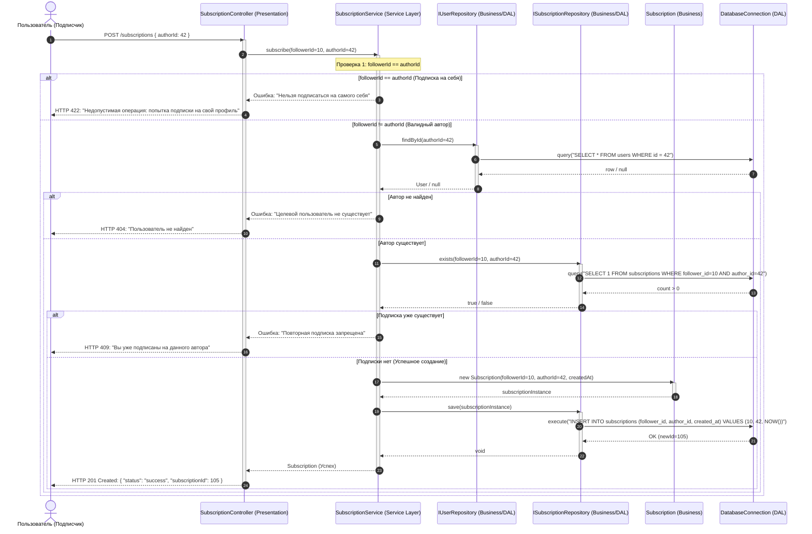
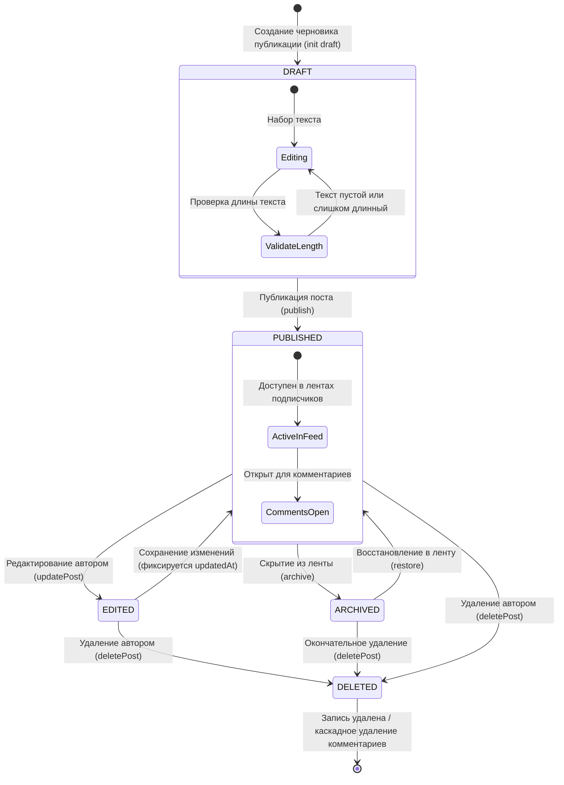
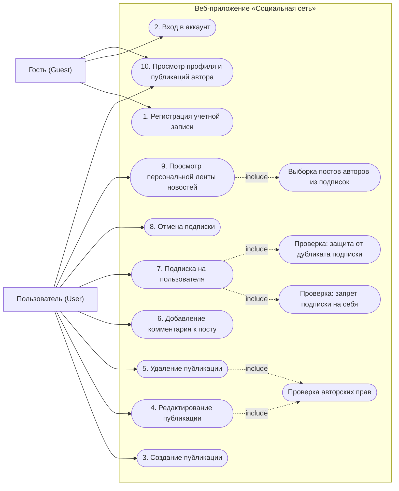

# Лабораторная работа №5: Архитектурное проектирование веб-приложения
## Вариант 13: «Социальная сеть» (Архитектурный шаблон: MVC + Service Layer)

> 📌 **Базовый референс:** Архитектура и структура проекта выполнены с опорой на эталонную работу [tigranbabayan2008g-ops/Lab](https://github.com/tigranbabayan2008g-ops/Lab).

---

## Оглавление
1. [Цель работы и суть задачи](#1-цель-работы-и-суть-задачи)
2. [Выбор архитектуры: MVC + Service Layer](#2-выбор-архитектуры-mvc--service-layer)
   - [Схема распределения слоев](#схема-распределения-слоев)
   - [Описание слоев и зоны ответственности](#описание-слоев-и-зоны-ответственности)
3. [Описание компонентов системы](#3-описание-компонентов-системы)
   - [Сущности (Entities / Models)](#сущности-entities--models)
   - [Сервисы (Service Layer)](#сервисы-service-layer)
   - [Контроллеры (Presentation Layer)](#контроллеры-presentation-layer)
   - [Таблица взаимодействия компонентов по слоям](#таблица-взаимодействия-компонентов-по-слоям)
4. [UML-диаграммы и их подробное объяснение](#4-uml-диаграммы-и-их-подробное-объяснение)
   - [4.1. Диаграмма классов (Class Diagram)](#41-диаграмма-классов-class-diagram)
   - [4.2. Диаграмма последовательности (Sequence Diagram)](#42-диаграмма-последовательности-sequence-diagram)
   - [4.3. Диаграмма состояний публикации (State Diagram)](#43-диаграмма-состояний-публикации-state-diagram)
   - [4.4. Диаграмма прецедентов (Use Case Diagram)](#44-диаграмма-прецедентов-use-case-diagram)
5. [Описание алгоритмов и логика ключевых сценариев](#5-описание-алгоритмов-и-логика-ключевых-сценариев)
   - [Сценарий 1: Оформление подписки с валидацией бизнес-правил](#сценарий-1-оформление-подписки-с-валидацией-бизнес-правил)
   - [Сценарий 2: Формирование и пагинация персональной ленты новостей](#сценарий-2-формирование-и-пагинация-персональной-ленты-новостей)
   - [Сценарий 3: Редактирование и удаление поста с проверкой авторства](#сценарий-3-редактирование-и-удаление-поста-с-проверкой-авторства)
6. [Спецификация DTO и эндпоинтов](#6-спецификация-dto-и-эндпоинтов)
7. [Бизнес-правила системы](#7-бизнес-правила-системы)
8. [Вывод](#8-вывод)

---

## 1. Цель работы и суть задачи

Цель данной работы — спроектировать модульную архитектуру бэкенда для компактной социальной сети по Варианту 13 без написания исполняемого серверного кода на PHP, используя принципы объектно-ориентированного анализа, шаблоны **MVC + Service Layer** и стандарт моделирования **UML 2.5**.

Основная задача системы заключается в четком разделении ответственности компонентов: предоставить пользователям возможность публиковать посты, оставлять комментарии, подписываться на других авторов и просматривать персональную новостную ленту, строго инкапсулировав бизнес-ограничения (запрет подписки на себя, предотвращение дублирующих подписок, контроль авторских прав) в сервисном слое.

---

## 2. Выбор архитектуры: MVC + Service Layer

В стандартном шаблоне MVC контроллеры имеют тенденцию накапливать прикладную логику и превращаться в «толстые контроллеры» (Fat Controllers). Когда валидация данных, проверки прав, работа с SQL и предметные правила пишутся в методах контроллера, система теряет тестируемость, а код становится невозможно переиспользовать в других интерфейсах (например, в REST API или CLI).

Для устранения этих недостатков архитектура дополнена сервисным слоем (**Service Layer**):

### Схема распределения слоев

```text
┌────────────────────────────────────────────────────────────────────────┐
│                    PRESENTATION LAYER (Контроллеры)                    │
│   Прием входящих HTTP-запросов (REST API / Web UI).                    │
│   Считывание входных параметров и проверка HTTP-форматов.              │
│   ТОНКИЕ КОНТРОЛЛЕРЫ: отсутствие бизнес-правил и SQL-запросов!        │
└───────────────────────────────────┬────────────────────────────────────┘
                                    │ Вызовы сервисов / Передача DTO
┌───────────────────────────────────▼────────────────────────────────────┐
│                  APPLICATION / SERVICE LAYER (Сервисы)                 │
│   PostService, SubscriptionService, FeedService, UserService.          │
│   Инкапсуляция всей бизнес-логики и сценариев приложения.              │
│   Проверка запрета самоподписки, дубликатов, авторства постов.         │
└───────────────────────────────────┬────────────────────────────────────┘
                                    │ Контракты интерфейсов / Домен
┌───────────────────────────────────▼────────────────────────────────────┐
│                    BUSINESS LAYER (Сущности и Модели)                  │
│   Доменные сущности: User, Post, Comment, Subscription.                │
│   Инварианты моделей, геттеры/сеттеры, бизнес-методы сущностей.        │
│   Интерфейсы репозиториев (IPostRepository, ISubscriptionRepository).  │
└───────────────────────────────────▲────────────────────────────────────┘
                                    │ Реализация интерфейсов (DIP)
┌───────────────────────────────────┴────────────────────────────────────┐
│                   DATA ACCESS LAYER (DAL / Репозитории)                │
│   SqlUserRepository, SqlPostRepository, SqlSubscriptionRepository.     │
│   DatabaseConnection — управление PDO-соединением и транзакциями.      │
│   ИНКАПСУЛЯЦИЯ: ВСЯ РАБОТА С БД И SQL ТОЛЬКО В ЭТОМ СЛОЕ!              │
└────────────────────────────────────────────────────────────────────────┘
```

### Описание слоев и зоны ответственности
1. **Тонкие контроллеры (Thin Controllers):** Контроллер работает исключительно как диспетчер. Он считывает входящие данные запроса (ID пользователя из авторизационной сессии, тело POST-запроса), передает аргументы в соответствующий метод сервиса, перехватывает результат и возвращает клиенту HTTP-ответ.
2. **Сервисный слой (Service Layer):** Оркестрирует прикладные сценарии. Сервисы не зависят от глобального HTTP-контекста, сессий или кук. Они реализуют все бизнес-инварианты, обращаются к репозиториям и возвращают доменные объекты либо выбрасывают исключения.
3. **Бизнес-модель (Business Layer):** Содержит доменные сущности и абстрактные интерфейсы репозиториев, реализуя принцип инверсии зависимостей (Dependency Inversion Principle, DIP).
4. **Слой данных (DAL):** Инкапсулирует низкоуровневые SQL-запросы к СУБД.

---

## 3. Описание компонентов системы

### Сущности (Entities / Models)

- **`User` (Пользователь)**
  - **Зона ответственности:** представление профиля пользователя и учетных данных в системе.
  - **Свойства:** `id` (int), `username` (string), `email` (string), `passwordHash` (string), `createdAt` (string).
  - **Методы:** чтение идентификатора, имени, почты, проверка пароля.

- **`Post` (Публикация / Пост)**
  - **Зона ответственности:** хранение публикации, авторства, текста и временных отметок.
  - **Свойства:** `id` (int), `authorId` (int), `text` (string), `status` (PostStatus), `createdAt` (string), `updatedAt` (string).
  - **Методы:** `isCreatedBy(userId)` (проверка авторства), `updateText(newText)` (обновление текста с установкой `updatedAt`), `publish()`.

- **`Comment` (Комментарий)**
  - **Зона ответственности:** фиксация комментария пользователя к определенному посту.
  - **Свойства:** `id` (int), `postId` (int), `authorId` (int), `text` (string), `createdAt` (string).
  - **Методы:** получение идентификаторов и текста, валидация длины комментария.

- **`Subscription` (Подписка)**
  - **Зона ответственности:** фиксация однонаправленной связи между подписчиком и отслеживаемым автором.
  - **Свойства:** `id` (int), `followerId` (int), `authorId` (int), `createdAt` (string).
  - **Методы:** получение идентификаторов участников подписки.

---

### Сервисы (Service Layer)

- **`PostService`**
  - **Зона ответственности:** бизнес-логика создания, редактирования, удаления публикаций и добавления комментариев.
  - **Методы:**
    - `createPost(authorId, text)` — валидация контента и сохранение нового поста;
    - `updatePost(postId, authorId, newText)` — проверка прав автора (`authorId == post.authorId`), обновление текста и даты `updatedAt`;
    - `deletePost(postId, authorId)` — проверка прав автора и удаление поста;
    - `addComment(postId, authorId, text)` — проверка существования поста и добавление комментария;
    - `getPostWithComments(postId)` — выборка поста со связанными комментариями.

- **`SubscriptionService`**
  - **Зона ответственности:** реализация бизнес-правил подписки и отписки.
  - **Методы:**
    - `subscribe(followerId, authorId)` — валидация запрета подписки на себя, проверка существования автора, проверка отсутствия дубликата и сохранение связи;
    - `unsubscribe(followerId, authorId)` — удаление связи подписки;
    - `isSubscribed(followerId, authorId)` — проверка активной подписки;
    - `getFollowingIds(followerId)` — получение списка ID отслеживаемых авторов.

- **`FeedService`**
  - **Зона ответственности:** формирование персонализированной новостной ленты для пользователя.
  - **Методы:**
    - `getPersonalFeed(userId, limit, offset)` — получение подписок через `SubscriptionService`, выборка публикаций этих авторов, упорядочивание `createdAt DESC` и применение пагинации.

- **`UserService`**
  - **Зона ответственности:** управление жизненным циклом профилей, хэширование паролей и регистрация.
  - **Методы:** `registerUser(username, email, password)`, `authenticate(email, password)`, `getUserById(id)`.

---

### Контроллеры (Presentation Layer)

- **`UserController`:** `register()`, `login()`, `getProfile(userId)`.
- **`PostController`:** `createPost()`, `updatePost()`, `deletePost()`, `getPost()`, `addComment()`, `getFeed()`.
- **`SubscriptionController`:** `subscribe()`, `unsubscribe()`, `getFollowers()`, `getFollowing()`.

---

### Таблица взаимодействия компонентов по слоям

| Слой | Компонент | Зона ответственности |
|---|---|---|
| **Presentation** | `UserController` | Прием HTTP-запросов регистрации, авторизации и профилей |
| **Presentation** | `PostController` | Эндпоинты постов, комментариев и ленты, делегирование в сервисы |
| **Presentation** | `SubscriptionController` | Обработка действий подписки/отписки и списков читателей |
| **Service** | `UserService` | Проверка уникальности email/логина, хэширование паролей, логика авторизации |
| **Service** | `PostService` | Создание постов, проверка авторских прав, обновление дат, валидация комментариев |
| **Service** | `SubscriptionService` | Проверка запрета самоподписки, дубликатов, отписка, выдача списка отслеживаемых авторов |
| **Service** | `FeedService` | Агрегация постов отслеживаемых авторов, обратная сортировка (`createdAt DESC`), пагинация |
| **Business** | `User`, `Post`, `Comment`, `Subscription` | Доменные сущности, бизнес-инварианты и методы изменения состояния |
| **Business** | `IUserRepository`, `IPostRepository` и др. | Абстрактные контракты доступа к данным (DIP) |
| **Data Access** | `SqlUserRepository`, `SqlPostRepository` | Выполнение SQL-запросов к таблицам `users`, `posts` |
| **Data Access** | `SqlCommentRepository`, `SqlSubscriptionRepository` | SQL-запросы к таблицам `comments`, `subscriptions` |
| **Data Access** | `DatabaseConnection` | Низкоуровневое управление соединением с СУБД и транзакциями |

---

## 4. UML-диаграммы и их подробное объяснение

### 4.1. Диаграмма классов (Class Diagram)

```mermaid
classDiagram
    direction TB

    class PostStatus {
        <<enumeration>>
        DRAFT
        PUBLISHED
        ARCHIVED
    }

    class UserController {
        -UserService userService
        +register(request) Response
        +login(request) Response
        +getProfile(int userId) Response
    }

    class PostController {
        -PostService postService
        -FeedService feedService
        +createPost(request) Response
        +updatePost(int postId, request) Response
        +deletePost(int postId, request) Response
        +getPost(int postId) Response
        +addComment(int postId, request) Response
        +getFeed(request) Response
    }

    class SubscriptionController {
        -SubscriptionService subscriptionService
        +subscribe(request) Response
        +unsubscribe(request) Response
        +getFollowers(int userId) Response
        +getFollowing(int userId) Response
    }

    class UserService {
        -IUserRepository userRepo
        +registerUser(string username, string email, string password) User
        +authenticate(string email, string password) string
        +getUserById(int id) User
    }

    class PostService {
        -IPostRepository postRepo
        -ICommentRepository commentRepo
        -IUserRepository userRepo
        +createPost(int authorId, string text) Post
        +updatePost(int postId, int authorId, string newText) Post
        +deletePost(int postId, int authorId) bool
        +addComment(int postId, int authorId, string text) Comment
        +getPostWithComments(int postId) Post
    }

    class SubscriptionService {
        -ISubscriptionRepository subscriptionRepo
        -IUserRepository userRepo
        +subscribe(int followerId, int authorId) Subscription
        +unsubscribe(int followerId, int authorId) bool
        +isSubscribed(int followerId, int authorId) bool
        +getFollowingIds(int followerId) List~int~
    }

    class FeedService {
        -SubscriptionService subscriptionService
        -IPostRepository postRepo
        +getPersonalFeed(int userId, int limit, int offset) List~Post~
    }

    class User {
        +int id
        +string username
        +string email
        +string passwordHash
        +string createdAt
        +getId() int
        +getUsername() string
        +getEmail() string
    }

    class Post {
        +int id
        +int authorId
        +string text
        +PostStatus status
        +string createdAt
        +string updatedAt
        +isCreatedBy(int userId) bool
        +updateText(string newText) void
        +publish() void
    }

    class Comment {
        +int id
        +int postId
        +int authorId
        +string text
        +string createdAt
        +getId() int
        +getText() string
    }

    class Subscription {
        +int id
        +int followerId
        +int authorId
        +string createdAt
        +getFollowerId() int
        +getAuthorId() int
    }

    class IUserRepository {
        <<interface>>
        +save(User user) void
        +findById(int id) User
        +findByEmail(string email) User
        +findByUsername(string username) User
    }

    class IPostRepository {
        <<interface>>
        +save(Post post) void
        +update(Post post) void
        +delete(int id) void
        +findById(int id) Post
        +findByAuthorIds(List~int~ authorIds, int limit, int offset) List~Post~
        +findByAuthorId(int authorId) List~Post~
    }

    class ICommentRepository {
        <<interface>>
        +save(Comment comment) void
        +findByPostId(int postId) List~Comment~
        +delete(int id) void
    }

    class ISubscriptionRepository {
        <<interface>>
        +save(Subscription subscription) void
        +delete(int followerId, int authorId) void
        +exists(int followerId, int authorId) bool
        +findFollowingIds(int followerId) List~int~
        +findFollowersIds(int authorId) List~int~
    }

    class DatabaseConnection {
        -string dsn
        +query(string sql, array params)
        +execute(string sql, array params)
    }

    class SqlUserRepository {
        -DatabaseConnection db
        +save(User user) void
        +findById(int id) User
        +findByEmail(string email) User
        +findByUsername(string username) User
    }

    class SqlPostRepository {
        -DatabaseConnection db
        +save(Post post) void
        +update(Post post) void
        +delete(int id) void
        +findById(int id) Post
        +findByAuthorIds(List~int~ authorIds, int limit, int offset) List~Post~
        +findByAuthorId(int authorId) List~Post~
    }

    class SqlCommentRepository {
        -DatabaseConnection db
        +save(Comment comment) void
        +findByPostId(int postId) List~Comment~
        +delete(int id) void
    }

    class SqlSubscriptionRepository {
        -DatabaseConnection db
        +save(Subscription subscription) void
        +delete(int followerId, int authorId) void
        +exists(int followerId, int authorId) bool
        +findFollowingIds(int followerId) List~int~
        +findFollowersIds(int authorId) List~int~
    }

    UserController --> UserService
    PostController --> PostService
    PostController --> FeedService
    SubscriptionController --> SubscriptionService

    FeedService --> SubscriptionService
    FeedService ..> IPostRepository
    UserService ..> IUserRepository
    PostService ..> IPostRepository
    PostService ..> ICommentRepository
    PostService ..> IUserRepository
    SubscriptionService ..> ISubscriptionRepository
    SubscriptionService ..> IUserRepository

    User "1" --> "*" Post : автор постов
    User "1" --> "*" Comment : автор комментариев
    Post "1" --> "*" Comment : содержит
    Post --> PostStatus
    User "1" --> "*" Subscription : подписчик (follower)
    User "1" --> "*" Subscription : целевой автор (author)

    SqlUserRepository ..|> IUserRepository
    SqlPostRepository ..|> IPostRepository
    SqlCommentRepository ..|> ICommentRepository
    SqlSubscriptionRepository ..|> ISubscriptionRepository

    SqlUserRepository --> DatabaseConnection
    SqlPostRepository --> DatabaseConnection
    SqlCommentRepository --> DatabaseConnection
    SqlSubscriptionRepository --> DatabaseConnection
```



---

### 4.2. Диаграмма последовательности (Sequence Diagram)

Диаграмма иллюстрирует процесс **оформления подписки** с последовательной проверкой инвариантов бизнес-слоя:



---

### 4.3. Диаграмма состояний публикации (State Diagram)



---

### 4.4. Диаграмма прецедентов (Use Case Diagram)



---

## 5. Описание алгоритмов и логика ключевых сценариев

### Сценарий 1: Оформление подписки с валидацией бизнес-правил
1. Пользователь инициирует подписку на странице автора.
2. Контроллер `SubscriptionController.subscribe()` считывает `followerId` и `authorId` и вызывает `SubscriptionService.subscribe()`.
3. Сервис выполняет проверку: если `followerId == authorId`, выбрасывается ошибка «Нельзя подписаться на самого себя».
4. Сервис проверяет существование целевого автора в репозитории пользователей.
5. Сервис проверяет отсутствие активной подписки через `SubscriptionRepository.exists()`.
6. При успехе создается запись `Subscription` и фиксируется в базе данных.

### Сценарий 2: Формирование и пагинация персональной ленты новостей
1. Пользователь переходит на страницу «Лента» (`GET /feed`).
2. `PostController.getFeed()` передает ID пользователя в `FeedService.getPersonalFeed(userId, limit, offset)`.
3. `FeedService` запрашивает массив ID авторов у `SubscriptionService.getFollowingIds(userId)`.
4. Если массив пуст, сразу возвращается пустой список.
5. Если подписки есть, выполняется выборка постов с условием `authorId IN (...)` и сортировкой `createdAt DESC`.
6. К выборке применяются параметры пагинации (`limit`, `offset`), посты обогащаются комментариями и передаются в контроллер.

### Сценарий 3: Редактирование и удаление поста с проверкой авторства
1. Запрос на изменение текста поста поступает в `PostController.updatePost(postId, request)`.
2. `PostService` извлекает запись поста и проверяет условие: `post.authorId == currentUserId`.
3. Если авторство не подтверждено, операция прерывается с ошибкой доступа 403 Forbidden.
4. При успешной проверке текст обновляется, устанавливается новое значение `updatedAt`, и изменения сохраняются.

---

## 6. Спецификация DTO и эндпоинтов

### Форматы передачи данных (DTO)
```json
// Создание публикации (CreatePostDTO)
{
  "text": "Текст новой публикации в социальной сети"
}

// Карточка публикации (PostResponseDTO)
{
  "id": 101,
  "authorId": 14,
  "authorUsername": "ivan_dev",
  "text": "Текст новой публикации в социальной сети",
  "status": "PUBLISHED",
  "createdAt": "2026-11-17T18:00:00Z",
  "updatedAt": "2026-11-17T18:00:00Z",
  "commentsCount": 0
}

// Запрос на подписку (SubscribeRequestDTO)
{
  "authorId": 42
}
```

---

## 7. Бизнес-правила системы

1. **Запрет подписки на самого себя:** $followerId \ne authorId$.
2. **Защита от повторной подписки:** уникальность пары $(follower\_id, author\_id)$.
3. **Контроль авторства:** только создатель публикации имеет право ее редактировать и удалять ($post.authorId == currentUserId$).
4. **Обратная хронология:** лента всегда сортируется от самых свежих постов к более ранним ($\text{ORDER BY } createdAt \text{ DESC}$).
5. **Чистые контроллеры:** контроллеры лишены SQL-запросов и бизнес-логики; вся персистентность вынесена в DAL.

---

## 8. Вывод

В ходе лабораторной работы была спроектирована целостная архитектура веб-приложения социальной сети (Вариант 13) по образцу референсного проекта [tigranbabayan2008g-ops/Lab](https://github.com/tigranbabayan2008g-ops/Lab). 

Использование шаблона **MVC + Service Layer** позволило надежно изолировать правила предметной области в специализированных сервисах, сохранив контроллеры компактными диспетчерами. Комплект диаграмм классов, состояний, последовательности и прецедентов UML 2.5 обеспечивает полную прозрачность архитектуры и готовность к программной реализации.
