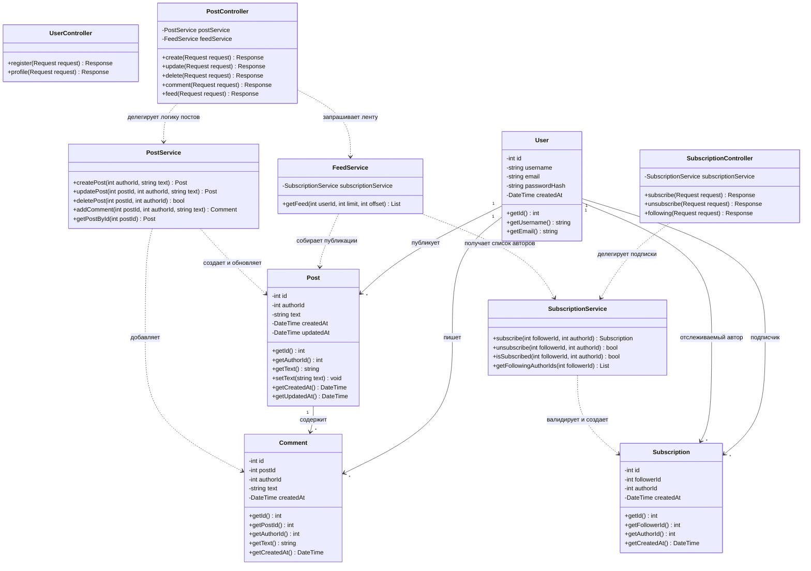

# Лабораторная работа №5: Архитектурное проектирование веб-приложения
## Вариант 13. Социальная сеть (Архитектурный паттерн: MVC + Service Layer)

---

## 1. Цель работы и суть задачи

Цель данной работы — спроектировать архитектуру бэкенда для компактной социальной сети, используя связку MVC (Model-View-Controller) и Service Layer (сервисный слой). Основная задача заключается в грамотном разделении обязанностей: дать пользователям возможность публиковать посты, комментировать записи, подписываться на интересных авторов и просматривать персональную ленту, при этом надежно изолировав бизнес-правила (запрет подписки на себя, предотвращение дублей подписок, контроль авторства) от уровня HTTP-контроллеров.

---

## 2. Выбор архитектуры: MVC + Service Layer

В стандартном MVC часто возникает проблема «толстых контроллеров» (Fat Controllers): когда проект разрастается, разработчики начинают писать валидацию, проверки прав доступа, выборки из базы и сложную бизнес-логику прямо в методах контроллера. В итоге контроллер превращается в нечитаемую «портянку» на сотни строк, которую тяжело поддерживать, практически невозможно переиспользовать (например, для мобильного API или консольных команд) и очень сложно покрывать юнит-тестами.

Чтобы этого избежать, мы дополняем классический MVC сервисным слоем (Service Layer):

- **Тонкие контроллеры (Thin Controllers):** контроллер работает как простой диспетчер. Он принимает входящий HTTP-запрос, считывает входные параметры (ID пользователя из сессии, данные из POST/GET), передает их в соответствующий сервис, ловит ответ (или ошибку) и отдает клиенту готовый результат (шаблон страницы или JSON-ответ). Контроллер ничего не знает о тонкостях бизнес-правил.
- **Сервисный слой (Service Layer):** именно здесь сосредоточена вся бизнес-логика и сценарии работы приложения. Сервисы не привязаны к вебу: они не работают напрямую с глобальными массивами `$_POST`, сессиями или куками. Они принимают понятные аргументы, проверяют бизнес-ограничения, вызывают модели/репозитории и возвращают готовые сущности или выбрасывают понятные ошибки.
- **Модели (Entities):** отражают данные предметной области, их структуру и связи в базе данных.

Такое разделение делает систему гибкой: любую операцию (например, создание поста или подписку) можно вызвать как из веб-интерфейса, так и из фонового скрипта или API без дублирования логики.

---

## 3. Описание компонентов системы

В проектировании не используются громоздкие таблицы — все компоненты и их обязанности четко структурированы списками.

### Сущности (Entities / Models)

- **User (Пользователь)**
  - **Зона ответственности:** хранит профиль пользователя системы и учетные данные для авторизации.
  - **Свойства:**
    - `id` — целочисленный первичный ключ учетной записи;
    - `username` — никнейм или имя пользователя;
    - `email` — адрес электронной почты;
    - `passwordHash` — хэш пароля для безопасной аутентификации;
    - `createdAt` — дата и время регистрации аккаунта.
  - **Методы:** базовые геттеры и сеттеры для чтения и обновления персональных данных.

- **Post (Публикация / Пост)**
  - **Зона ответственности:** представляет текстовую публикацию автора в социальной сети.
  - **Свойства:**
    - `id` — идентификатор публикации;
    - `authorId` — идентификатор пользователя, создавшего пост (внешний ключ к User);
    - `text` — текст сообщения;
    - `createdAt` — точная дата и время создания записи;
    - `updatedAt` — дата и время последнего редактирования.
  - **Методы:** получение параметров записи, изменение текста поста с автоматическим обновлением даты `updatedAt`.

- **Comment (Комментарий)**
  - **Зона ответственности:** хранит комментарий определенного пользователя под конкретной публикацией.
  - **Свойства:**
    - `id` — идентификатор комментария;
    - `postId` — ссылка на публикацию (внешний ключ к Post);
    - `authorId` — автор комментария (внешний ключ к User);
    - `text` — текст комментария;
    - `createdAt` — время создания комментария.
  - **Методы:** чтение полей комментария, валидация непустого текста.

- **Subscription (Подписка)**
  - **Зона ответственности:** фиксирует связь подписки одного пользователя на другого.
  - **Свойства:**
    - `id` — идентификатор связи;
    - `followerId` — ID пользователя, который подписывается;
    - `authorId` — ID автора, на чьи посты оформлена подписка;
    - `createdAt` — дата и время оформления подписки.
  - **Методы:** чтение идентификаторов подписчика и автора.

---

### Сервисы (Service Layer)

- **PostService (Сервис постов и комментариев)**
  - **Зона ответственности:** создание, редактирование, удаление публикаций, привязка комментариев и проверка прав автора на контент.
  - **Методы:**
    - `createPost(authorId, text)` — проверяет длину и наполненность текста, создает новую запись Post и сохраняет ее;
    - `updatePost(postId, authorId, text)` — проверяет наличие поста, валидирует, что текущий `authorId` действительно является создателем публикации (защита от несанкционированного изменения чужих постов), обновляет текст и дату изменения;
    - `deletePost(postId, authorId)` — проверяет права доступа автора и удаляет выбранную публикацию;
    - `addComment(postId, authorId, text)` — проверяет существование целевого поста, валидирует текст комментария и сохраняет новый Comment;
    - `getPostById(postId)` — возвращает публикацию вместе со списком комментариев и информацией об авторе.

- **SubscriptionService (Сервис управления подписками)**
  - **Зона ответственности:** реализация бизнес-правил взаимоотношений между пользователями (подписка, отписка, проверки).
  - **Методы:**
    - `subscribe(followerId, authorId)` — выполняет проверки: запрет подписки на себя (`followerId != authorId`), существование автора и отсутствие уже созданной подписки. При успехе создает запись Subscription;
    - `unsubscribe(followerId, authorId)` — находит существующую подписку и удаляет ее;
    - `isSubscribed(followerId, authorId)` — проверяет, подписан ли уже один пользователь на другого;
    - `getFollowingAuthorIds(followerId)` — возвращает массив идентификаторов авторов, на которых подписан конкретный пользователь.

- **FeedService (Сервис формирования ленты новостей)**
  - **Зона ответственности:** сборка и сортировка персонального потока публикаций для конкретного читателя.
  - **Методы:**
    - `getFeed(userId, limit, offset)` — обращается к `SubscriptionService` за списком подписок пользователя, выбирает публикации этих авторов, сортирует их в обратном хронологическом порядке (сначала новые) и применяет пагинацию.

---

### Контроллеры (HTTP / Web Layer)

- **UserController**
  - **Зона ответственности:** обработка запросов регистрации и отображения профиля.
  - **Методы:**
    - `register(request)` — принимает данные из формы, передает их на регистрацию, возвращает страницу успеха или ошибки;
    - `profile(request)` — считывает ID пользователя из маршрута и отдает данные страницы профиля.

- **PostController**
  - **Зона ответственности:** точка входа для всех HTTP-действий над публикациями и комментариями, а также отображения новостной ленты.
  - **Методы:**
    - `create(request)` — извлекает текст поста и ID авторизованного пользователя, вызывает `PostService.createPost()`, перенаправляет на страницу поста;
    - `update(request)` — обрабатывает форму редактирования, передавая данные в `PostService.updatePost()`;
    - `delete(request)` — обрабатывает удаление поста через `PostService.deletePost()`;
    - `comment(request)` — принимает комментарий и передает его в `PostService.addComment()`;
    - `feed(request)` — запрашивает у `FeedService.getFeed()` персональную ленту для текущего пользователя и передает данные во View.

- **SubscriptionController**
  - **Зона ответственности:** обработка действий пользователя по оформлению и отмене подписок.
  - **Методы:**
    - `subscribe(request)` — считывает ID автора, на которого хотят подписаться, и текущего пользователя, вызывает `SubscriptionService.subscribe()`;
    - `unsubscribe(request)` — инициирует удаление подписки через `SubscriptionService.unsubscribe()`;
    - `following(request)` — отдает список пользователей, на которых подписан текущий аккаунт.

---

## 4. Логика ключевых сценариев

### Сценарий 1: Оформление подписки (с бизнес-проверками)

1. Пользователь нажимает кнопку «Подписаться» на странице автора.
2. Веб-клиент отправляет POST-запрос на маршрут `/subscriptions/subscribe` с параметром `authorId`.
3. Запрос попадает в метод `SubscriptionController.subscribe(request)`.
4. Контроллер достает ID авторизованного пользователя (`followerId`) из сессии и `authorId` из параметров запроса, после чего сразу вызывает `SubscriptionService.subscribe(followerId, authorId)`.
5. Внутри `SubscriptionService` последовательно проверяются жесткие бизнес-правила:
   - **Проверка на самого себя:** если `followerId == authorId`, сервис выбрасывает исключение с понятной ошибкой: «Нельзя подписаться на самого себя».
   - **Проверка существования автора:** сервис проверяет, существует ли аккаунт с переданным `authorId`. Если нет — выбрасывается исключение «Пользователь не найден».
   - **Защита от дубликата:** сервис вызывает внутреннюю проверку `isSubscribed(followerId, authorId)`. Если запись уже есть — выбрасывается исключение «Вы уже подписаны на данного пользователя».
6. Если проверки пройдены, сервис создает объект `Subscription` и фиксирует его в хранилище.
7. Контроллер перехватывает результат: если все прошло успешно — возвращает редирект или статус успеха; если сервис выбросил ошибку — контроллер отдает пользователю понятное предупреждение (например, HTTP 422 с текстом ошибки).

### Сценарий 2: Формирование персональной ленты новостей

1. Авторизованный пользователь открывает страницу «Моя лента» (маршрут `/feed`).
2. Запрос поступает в метод `PostController.feed(request)`.
3. Контроллер считывает ID текущего пользователя из сессии и запрашивает ленту у `FeedService.getFeed(userId, limit, offset)`.
4. `FeedService` обращается к сервису подписок: вызывает `SubscriptionService.getFollowingAuthorIds(userId)`.
5. Анализ списка подписок:
   - Если пользователь ни на кого не подписан (массив пуст), `FeedService` возвращает пустой список, предотвращая бессмысленные запросы к таблице постов.
   - Если подписки есть, `FeedService` делает выборку всех записей `Post`, у которых `authorId` входит в полученный список.
6. Выборка сортируется по убыванию даты: `createdAt DESC` (новые публикации первыми).
7. К выборке применяются параметры пагинации (`limit` и `offset`), чтобы не перегружать память.
8. Сформированный массив объектов `Post` возвращается в `PostController`.
9. Контроллер передает полученный список в представление (View), где посты отрисовываются для пользователя.

---

## 5. UML-диаграмма классов

Диаграмма наглядно демонстрирует разделение обязанностей: модели хранят данные, контроллеры служат точками входа для запросов, а вся логика делегируется сервисам.

---

## 6. Вывод

В ходе выполнения работы была полностью спроектирована архитектура социальной сети (Вариант 13) по принципам MVC + Service Layer:

1. **Разделение ответственности:** контроллеры освобождены от прикладной логики и выполняют исключительно роль связующего звена между HTTP-запросами и сервисами.
2. **Чистота бизнес-правил:** ключевые ограничения предметной области (запрет подписки на себя, предотвращение дублей, проверка авторства при редактировании и удалении постов) изолированы внутри соответствующих сервисов (`PostService`, `SubscriptionService`).
3. **Эффективное формирование ленты:** логика сборки персонального фида вынесена в специализированный `FeedService`, который взаимодействует с `SubscriptionService` и отдает упорядоченный список публикаций.
4. **Готовность к кодовой реализации:** построенная Mermaid-диаграмма классов и подробное описание сценариев позволяют сразу перейти к разработке на PHP (или любом другом серверном языке) с чистой и легко поддерживаемой кодовой базой.
