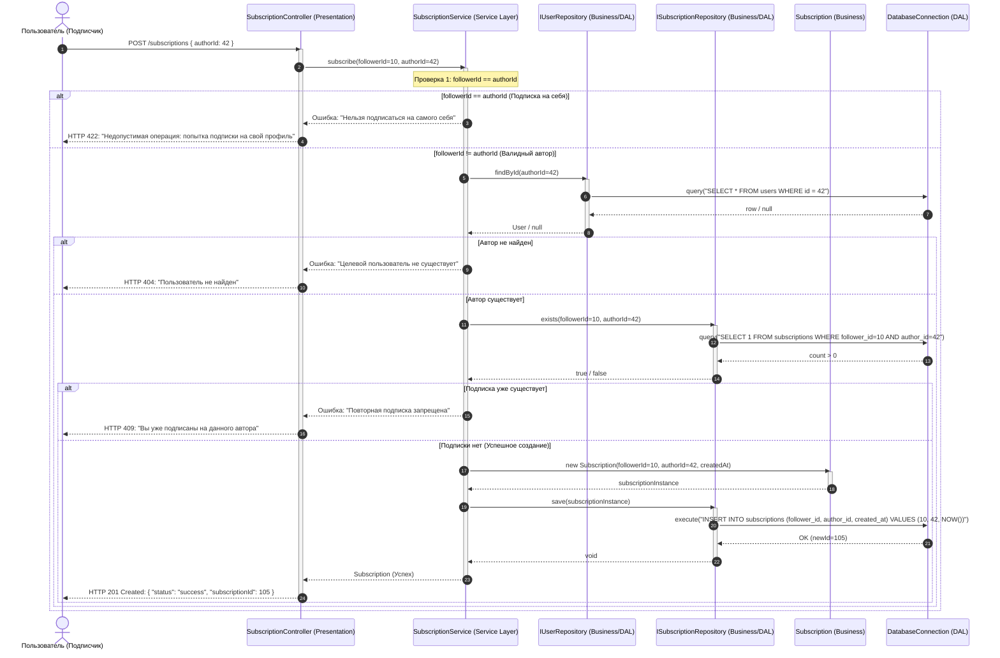
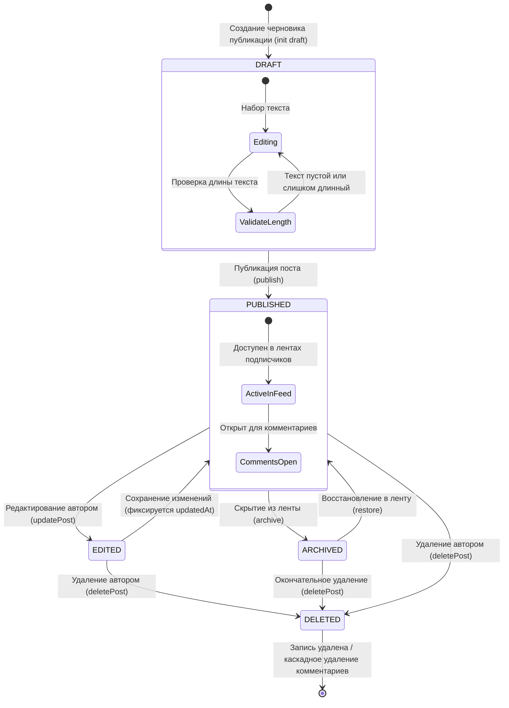
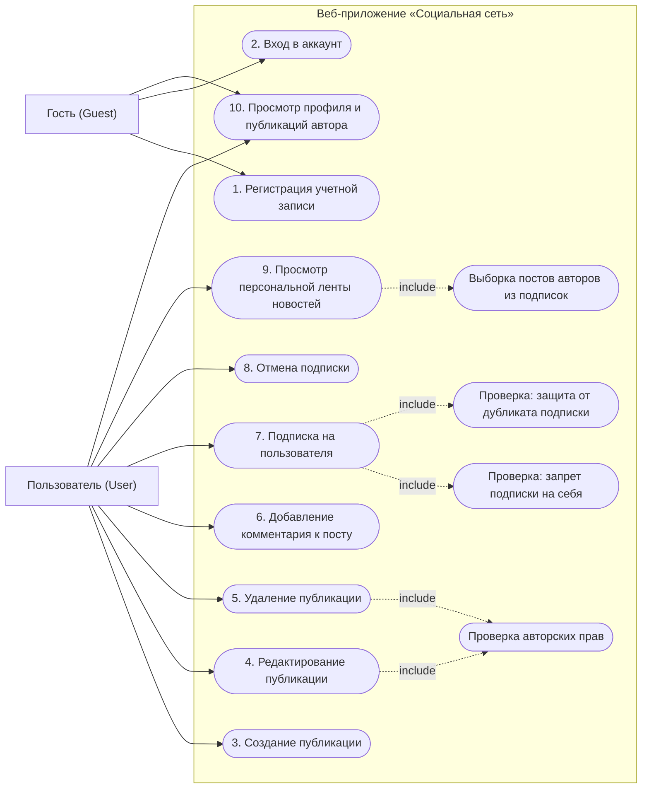

# Проектирование веб-приложения «Социальная сеть» (Вариант 13)

Архитектурное проектирование веб-приложения небольшой социальной сети на базе шаблона **MVC + Service Layer** (Model-View-Controller с сервисным слоем бизнес-логики), принципов **SOLID** и стандарта моделирования **UML 2.5**.

> 📌 **Базовый референс:** Архитектура и структура проекта выполнены с опорой на эталонную работу [tigranbabayan2008g-ops/Lab](https://github.com/tigranbabayan2008g-ops/Lab).

---

## Оглавление
1. [Описание предметной области и задачи](#1-описание-предметной-области-и-задачи)
   - [Основные возможности системы](#основные-возможности-системы)
2. [Архитектура приложения (MVC + Service Layer)](#2-архитектура-приложения-mvc--service-layer)
   - [Схема распределения слоев](#схема-распределения-слоев)
   - [Presentation Layer (Слой представления / Контроллеры)](#presentation-layer-слой-представления)
   - [Application / Service Layer (Сервисный слой)](#application--service-layer-сервисный-слой)
   - [Business Layer (Бизнес-модель / Сущности)](#business-layer-бизнес-модель--сущности)
   - [Data Access Layer (Слой доступа к данным / DAL)](#data-access-layer-слой-доступа-к-данным--dal)
   - [Таблица распределения компонентов по слоям](#таблица-распределения-компонентов-по-слоям)
3. [UML-диаграммы и их подробное объяснение](#3-uml-диаграммы-и-их-подробное-объяснение)
   - [3.1. Диаграмма классов (Class Diagram)](#31-диаграмма-классов-class-diagram)
   - [Подробное объяснение диаграммы классов](#подробное-объяснение-диаграммы-классов)
   - [3.2. Диаграмма последовательности (Sequence Diagram)](#32-диаграмма-последовательности-sequence-diagram)
   - [Пошаговое объяснение диаграммы последовательности](#пошаговое-объяснение-диаграммы-последовательности)
   - [3.3. Диаграмма состояний публикации (State Diagram)](#33-диаграмма-состояний-публикации-state-diagram)
   - [Объяснение жизненного цикла публикации](#объяснение-жизненного-цикла-публикации)
   - [3.4. Диаграмма прецедентов (Use Case Diagram)](#34-диаграмма-прецедентов-use-case-diagram)
   - [Объяснение диаграммы прецедентов](#объяснение-диаграммы-прецедентов)
4. [Описание алгоритмов](#4-описание-алгоритмов)
   - [Алгоритм оформления подписки с валидацией бизнес-правил](#алгоритм-оформления-подписки-с-валидацией-бизнес-правил)
   - [Алгоритм формирования и сортировки персональной ленты новостей](#алгоритм-формирования-и-сортировки-персональной-ленты-новостей)
   - [Алгоритм редактирования публикации с контролем авторских прав](#алгоритм-редактирования-публикации-с-контролем-авторских-прав)
   - [Алгоритм комментирования публикации](#алгоритм-комментирования-публикации)
5. [Спецификация интерфейсов и структуры данных (DTO)](#5-спецификация-интерфейсов-и-структуры-данных-dto)
   - [Форматы передачи данных (DTO в формате JSON)](#форматы-передачи-данных-dto-в-формате-json)
   - [Таблица взаимодействия эндпоинтов, сервисов и репозиториев](#таблица-взаимодействия-эндпоинтов-сервисов-и-репозиториев)
6. [Бизнес-правила системы](#6-бизнес-правила-системы)
7. [Вывод](#7-вывод)

---

## 1. Описание предметной области и задачи

Цель работы — выполнить архитектурное проектирование бэкенда веб-приложения социальной сети без непосредственного написания исполняемого PHP-кода, опираясь на объектно-ориентированный анализ, чистую архитектуру MVC с выделенным сервисным слоем (Service Layer) и стандарты UML.

### Основные возможности системы:
* **Управление профилями:** регистрация учетных записей пользователей, безопасное хранение хэшированных паролей и просмотр публичных профилей.
* **Публикация контента:** создание текстовых сообщений (постов) с автоматической фиксацией даты создания и изменения, а также удаление публикаций.
* **Редактирование записей:** возможность редактирования текста ранее созданного поста с обязательной проверкой прав владения (только автор может изменить свою запись) и автоматической фиксацией даты изменения `updatedAt`.
* **Обсуждение публикаций:** возможность оставлять комментарии под постами любых зарегистрированных пользователей.
* **Система подписок:** механизм подписки на интересных пользователей с защитой от самоподписки и дублирующих подписок.
* **Персональная новостная лента:** сборка хронологической ленты из публикаций тех авторов, на которых подписан текущий пользователь, с сортировкой «сначала новые» и пагинацией.

---

## 2. Архитектура приложения (MVC + Service Layer)

В классическом веб-приложении на базе MVC при добавлении бизнес-правил контроллеры быстро превращаются в перегруженные «толстые контроллеры» (Fat Controllers), смешивая HTTP-логику, валидацию форм, работу с базой данных и предметную область.

Для решения этой проблемы архитектура разделена на независимые слои в соответствии с принципами **SOLID** (в частности, Single Responsibility Principle и Dependency Inversion Principle).

### Схема распределения слоев

```text
┌────────────────────────────────────────────────────────────────────────┐
│                    PRESENTATION LAYER (Контроллеры)                    │
│   Прием входящих HTTP-запросов (REST API / Web UI).                    │
│   Считывание входных параметров и проверка HTTP-форматов.              │
│   ТОНКИЕ КОНТРОЛЛЕРЫ: отсутствие бизнес-правил и SQL-запросов!        │
└───────────────────────────────────┬────────────────────────────────────┘
                                    │ Вызовы сервисов / Передача DTO
┌───────────────────────────────────▼────────────────────────────────────┐
│                  APPLICATION / SERVICE LAYER (Сервисы)                 │
│   PostService, SubscriptionService, FeedService, UserService.          │
│   Инкапсуляция всей бизнес-логики и сценариев приложения.              │
│   Проверка запрета самоподписки, дубликатов, авторства постов.         │
└───────────────────────────────────┬────────────────────────────────────┘
                                    │ Контракты интерфейсов / Домен
┌───────────────────────────────────▼────────────────────────────────────┐
│                    BUSINESS LAYER (Сущности и Модели)                  │
│   Доменные сущности: User, Post, Comment, Subscription.                │
│   Инварианты моделей, геттеры/сеттеры, бизнес-методы сущностей.        │
│   Интерфейсы репозиториев (IPostRepository, ISubscriptionRepository).  │
└───────────────────────────────────▲────────────────────────────────────┘
                                    │ Реализация интерфейсов (DIP)
┌───────────────────────────────────┴────────────────────────────────────┐
│                   DATA ACCESS LAYER (DAL / Репозитории)                │
│   SqlUserRepository, SqlPostRepository, SqlSubscriptionRepository.     │
│   DatabaseConnection — управление PDO-соединением и транзакциями.      │
│   ИНКАПСУЛЯЦИЯ: ВСЯ РАБОТА С БД И SQL ТОЛЬКО В ЭТОМ СЛОЕ!              │
└────────────────────────────────────────────────────────────────────────┘
```

### Presentation Layer (Слой представления)
Служит внешней границей взаимодействия с клиентом:
* **`UserController`** — прием запросов на регистрацию, вход в систему и просмотр профилей.
* **`PostController`** — обработка запросов на создание, редактирование, удаление публикаций, добавление комментариев и получение ленты.
* **`SubscriptionController`** — обработка действий подписки, отмены подписки и просмотра подписчиков.

### Application / Service Layer (Сервисный слой)
Оркестрирует прикладные сценарии (Use Cases) и концентрирует в себе все бизнес-правила:
* **`UserService`** — регистрация, проверка уникальности логина/email, аутентификация.
* **`PostService`** — создание публикаций, проверка авторства при редактировании и удалении, добавление комментариев к существующим постам.
* **`SubscriptionService`** — бизнес-правила подписок: запрет подписки на себя, предотвращение дубликатов, отписка.
* **`FeedService`** — сборка и сортировка персональной ленты новостей на основе активных подписок.

### Business Layer (Бизнес-модель / Сущности)
Ядро предметной области социальной сети:
* **`User`** — учетная запись (`id`, `username`, `email`, `passwordHash`, `createdAt`).
* **`Post`** — публикация (`id`, `authorId`, `text`, `status`, `createdAt`, `updatedAt`).
* **`Comment`** — комментарий (`id`, `postId`, `authorId`, `text`, `createdAt`).
* **`Subscription`** — связь подписки (`id`, `followerId`, `authorId`, `createdAt`).
* **Интерфейсы репозиториев (`IUserRepository`, `IPostRepository`, `ICommentRepository`, `ISubscriptionRepository`)** — контракты абстракции данных.

### Data Access Layer (Слой доступа к данным / DAL)
Отвечает за персистентность и взаимодействие с реляционной базой данных:
* **`DatabaseConnection`** — управление безопасным подключением к СУБД, выполнение подготовленных выражений (`prepared statements`).
* **`Sql*Repository`** — конкретные реализации интерфейсов хранилищ. Здесь содержатся SQL-запросы (`SELECT`, `INSERT`, `UPDATE`, `DELETE`) и гидратация строк БД в доменные объекты.

---

### Таблица распределения компонентов по слоям

| Слой | Компонент | Роль и зона ответственности |
|---|---|---|
| **Presentation** | `UserController` | Прием HTTP-запросов регистрации, авторизации и просмотра профилей |
| **Presentation** | `PostController` | Эндпоинты постов, комментариев и ленты, делегирование в сервисы |
| **Presentation** | `SubscriptionController` | Обработка действий подписки/отписки и списков читателей |
| **Service** | `UserService` | Проверка уникальности email/логина, хэширование паролей, логика авторизации |
| **Service** | `PostService` | Создание постов, проверка авторских прав, обновление дат, валидация комментариев |
| **Service** | `SubscriptionService` | Проверка запрета самоподписки, дубликатов, отписка, выдача списка отслеживаемых авторов |
| **Service** | `FeedService` | Агрегация постов отслеживаемых авторов, обратная сортировка (`createdAt DESC`), пагинация |
| **Business** | `User`, `Post`, `Comment`, `Subscription` | Доменные сущности, бизнес-инварианты и методы изменения состояния |
| **Business** | `IUserRepository`, `IPostRepository` и др. | Абстрактные контракты доступа к данным (DIP) |
| **Data Access** | `SqlUserRepository`, `SqlPostRepository` | Выполнение SQL-запросов к таблицам `users`, `posts` |
| **Data Access** | `SqlCommentRepository`, `SqlSubscriptionRepository` | SQL-запросы к таблицам `comments`, `subscriptions` |
| **Data Access** | `DatabaseConnection` | Низкоуровневое управление соединением с СУБД и транзакциями |

---

## 3. UML-диаграммы и их подробное объяснение

### 3.1. Диаграмма классов (Class Diagram)

Диаграмма классов описывает статическую структуру системы, типизацию полей, сигнатуры методов и связи между слоями:

```mermaid
classDiagram
    direction TB

    %% Перечисления
    class PostStatus {
        <<enumeration>>
        DRAFT
        PUBLISHED
        ARCHIVED
    }

    %% ==========================================
    %% 1. PRESENTATION LAYER (Слой представления)
    %% ==========================================
    class UserController {
        -UserService userService
        +register(request) Response
        +login(request) Response
        +getProfile(int userId) Response
    }

    class PostController {
        -PostService postService
        -FeedService feedService
        +createPost(request) Response
        +updatePost(int postId, request) Response
        +deletePost(int postId, request) Response
        +getPost(int postId) Response
        +addComment(int postId, request) Response
        +getFeed(request) Response
    }

    class SubscriptionController {
        -SubscriptionService subscriptionService
        +subscribe(request) Response
        +unsubscribe(request) Response
        +getFollowers(int userId) Response
        +getFollowing(int userId) Response
    }

    %% ==========================================
    %% 2. APPLICATION / SERVICE LAYER (Сервисный слой)
    %% ==========================================
    class UserService {
        -IUserRepository userRepo
        +registerUser(string username, string email, string password) User
        +authenticate(string email, string password) string
        +getUserById(int id) User
    }

    class PostService {
        -IPostRepository postRepo
        -ICommentRepository commentRepo
        -IUserRepository userRepo
        +createPost(int authorId, string text) Post
        +updatePost(int postId, int authorId, string newText) Post
        +deletePost(int postId, int authorId) bool
        +addComment(int postId, int authorId, string text) Comment
        +getPostWithComments(int postId) Post
    }

    class SubscriptionService {
        -ISubscriptionRepository subscriptionRepo
        -IUserRepository userRepo
        +subscribe(int followerId, int authorId) Subscription
        +unsubscribe(int followerId, int authorId) bool
        +isSubscribed(int followerId, int authorId) bool
        +getFollowingIds(int followerId) List~int~
    }

    class FeedService {
        -SubscriptionService subscriptionService
        -IPostRepository postRepo
        +getPersonalFeed(int userId, int limit, int offset) List~Post~
    }

    %% ==========================================
    %% 3. BUSINESS LAYER (Бизнес-модель / Сущности)
    %% ==========================================
    class User {
        +int id
        +string username
        +string email
        +string passwordHash
        +string createdAt
        +getId() int
        +getUsername() string
        +getEmail() string
    }

    class Post {
        +int id
        +int authorId
        +string text
        +PostStatus status
        +string createdAt
        +string updatedAt
        +isCreatedBy(int userId) bool
        +updateText(string newText) void
        +publish() void
    }

    class Comment {
        +int id
        +int postId
        +int authorId
        +string text
        +string createdAt
        +getId() int
        +getText() string
    }

    class Subscription {
        +int id
        +int followerId
        +int authorId
        +string createdAt
        +getFollowerId() int
        +getAuthorId() int
    }

    %% Интерфейсы репозиториев (Контракты)
    class IUserRepository {
        <<interface>>
        +save(User user) void
        +findById(int id) User
        +findByEmail(string email) User
        +findByUsername(string username) User
    }

    class IPostRepository {
        <<interface>>
        +save(Post post) void
        +update(Post post) void
        +delete(int id) void
        +findById(int id) Post
        +findByAuthorIds(List~int~ authorIds, int limit, int offset) List~Post~
        +findByAuthorId(int authorId) List~Post~
    }

    class ICommentRepository {
        <<interface>>
        +save(Comment comment) void
        +findByPostId(int postId) List~Comment~
        +delete(int id) void
    }

    class ISubscriptionRepository {
        <<interface>>
        +save(Subscription subscription) void
        +delete(int followerId, int authorId) void
        +exists(int followerId, int authorId) bool
        +findFollowingIds(int followerId) List~int~
        +findFollowersIds(int authorId) List~int~
    }

    %% ==========================================
    %% 4. DATA ACCESS LAYER (Слой доступа к данным)
    %% ==========================================
    class DatabaseConnection {
        -string dsn
        +query(string sql, array params)
        +execute(string sql, array params)
    }

    class SqlUserRepository {
        -DatabaseConnection db
        +save(User user) void
        +findById(int id) User
        +findByEmail(string email) User
        +findByUsername(string username) User
    }

    class SqlPostRepository {
        -DatabaseConnection db
        +save(Post post) void
        +update(Post post) void
        +delete(int id) void
        +findById(int id) Post
        +findByAuthorIds(List~int~ authorIds, int limit, int offset) List~Post~
        +findByAuthorId(int authorId) List~Post~
    }

    class SqlCommentRepository {
        -DatabaseConnection db
        +save(Comment comment) void
        +findByPostId(int postId) List~Comment~
        +delete(int id) void
    }

    class SqlSubscriptionRepository {
        -DatabaseConnection db
        +save(Subscription subscription) void
        +delete(int followerId, int authorId) void
        +exists(int followerId, int authorId) bool
        +findFollowingIds(int followerId) List~int~
        +findFollowersIds(int authorId) List~int~
    }

    %% Связи Presentation -> Service
    UserController --> UserService
    PostController --> PostService
    PostController --> FeedService
    SubscriptionController --> SubscriptionService

    %% Связи Service -> Service / Interface
    FeedService --> SubscriptionService
    FeedService ..> IPostRepository
    UserService ..> IUserRepository
    PostService ..> IPostRepository
    PostService ..> ICommentRepository
    PostService ..> IUserRepository
    SubscriptionService ..> ISubscriptionRepository
    SubscriptionService ..> IUserRepository

    %% Связи между сущностями
    User "1" --> "*" Post : автор постов
    User "1" --> "*" Comment : автор комментариев
    Post "1" --> "*" Comment : содержит
    Post --> PostStatus
    User "1" --> "*" Subscription : подписчик (follower)
    User "1" --> "*" Subscription : целевой автор (author)

    %% Реализация интерфейсов (DAL ..|> Business)
    SqlUserRepository ..|> IUserRepository
    SqlPostRepository ..|> IPostRepository
    SqlCommentRepository ..|> ICommentRepository
    SqlSubscriptionRepository ..|> ISubscriptionRepository

    %% Связи DAL -> DatabaseConnection
    SqlUserRepository --> DatabaseConnection
    SqlPostRepository --> DatabaseConnection
    SqlCommentRepository --> DatabaseConnection
    SqlSubscriptionRepository --> DatabaseConnection
```



---

#### Подробное объяснение диаграммы классов

1. **Однонаправленный поток управления и слабая связность:**
   - Контроллеры (`UserController`, `PostController`, `SubscriptionController`) обращаются только к соответствующим сервисам через ассоциацию (`-->`).
   - Контроллеры не имеют доступа к сущностям базы данных напрямую и не зависят от деталей персистентности.
2. **Инверсия зависимостей (Dependency Inversion Principle, DIP):**
   - Сервисы зависят исключительно от интерфейсов репозиториев (`IPostRepository`, `ISubscriptionRepository` и др.), расположенных в бизнес-слое.
   - Реализации репозиториев (`Sql*Repository`) находятся в слое DAL и реализуют эти интерфейсы (`..|>`).
   - Это гарантирует, что замена СУБД (например, переход на PostgreSQL или Redis) не затронет бизнес-логику социальной сети.
3. **Модели и их отношения:**
   - `User "1" --> "*" Post`: один пользователь может создать множество постов.
   - `Post "1" --> "*" Comment`: каждый пост содержит произвольное число комментариев.
   - `User "1" --> "*" Subscription`: сущность подписки моделирует направленное отношение «многие ко многим» (M:N) между читателем (`follower`) и автором (`author`).
4. **Инкапсуляция логики сущности `Post`:**
   - Метод `isCreatedBy(userId)` проверяет авторство прямо в объекте модели.
   - Метод `updateText(newText)` автоматически обновляет временную метку `updatedAt`.

---

### 3.2. Диаграмма последовательности (Sequence Diagram)

Диаграмма иллюстрирует сквозной сценарий **«Оформление подписки на автора»** с валидацией бизнес-ограничений (запрет подписки на себя, существование автора, проверка дубликата):



---

#### Пошаговое объяснение диаграммы последовательности

1. **Инициация запроса:** Авторизованный пользователь (`id=10`) нажимает «Подписаться» на странице автора (`id=42`). `SubscriptionController` принимает запрос, извлекает параметры и вызывает `SubscriptionService.subscribe()`.
2. **Проверка инварианта самоподписки:** Сервис мгновенно сравнивает `followerId` и `authorId`. Если они равны, запрос блокируется без обращения к БД, и возвращается статус 422 Unprocessable Entity.
3. **Проверка существования автора:** Сервис вызывает репозиторий пользователей `IUserRepository.findById(42)`. Если пользователь не найден в базе, возвращается статус 404 Not Found.
4. **Проверка на повторную подписку:** Сервис проверяет наличие существующей связи через `ISubscriptionRepository.exists(10, 42)`. При обнаружении дубликата выполнение прерывается со статусом 409 Conflict.
5. **Создание и сохранение записи:** При успешном прохождении всех трех проверок создается сущность `Subscription`, фиксируется в таблице `subscriptions` через репозиторий, и клиенту возвращается подтверждение с HTTP-кодом 201 Created.

---

### 3.3. Диаграмма состояний публикации (State Diagram)

Диаграмма описывает полный жизненный цикл поста (`Post`) от создания до архивации и удаления:



---

#### Объяснение жизненного цикла публикации

1. **`DRAFT` (Черновик):** Состояние набора и подготовки текста публикации, в котором пост еще не виден в общей ленте подписчиков.
2. **`PUBLISHED` (Опубликован):** Пост виден в персональной ленте всех подписчиков автора и на его странице профиля. Пользователи могут оставлять комментарии.
3. **`EDITED` (Отредактирован):** Переходное состояние при внесении изменений автором поста. При сохранении нового текста фиксируется дата изменения `updatedAt`.
4. **`ARCHIVED` (В архиве):** Пост скрывается из общей ленты, но сохраняется в базе данных для автора.
5. **`DELETED` (Удален):** Окончательное удаление записи из системы с очисткой связанных комментариев.

---

### 3.4. Диаграмма прецедентов (Use Case Diagram)

Диаграмма прецедентов демонстрирует распределение прав доступа и сценариев использования между гостем и авторизованным пользователем:



---

#### Объяснение диаграммы прецедентов

1. **Акторы системы:**
   - **Гость (`Guest`):** Неавторизованный посетитель. Может пройти регистрацию, войти в систему или просматривать открытые публичные профили.
   - **Авторизованный пользователь (`User`):** Основной участник сети. Обладает правами на публикацию, комментирование, подписку и просмотр персональной ленты.
2. **Отношения включения (`<<include>>`):**
   - **Редактирование/удаление поста $\rightarrow$ Проверка авторских прав:** Любая попытка модификации поста проверяет соответствие ID автора и текущего пользователя.
   - **Подписка $\rightarrow$ Проверка запрета подписки на себя и отсутствия дубликатов:** Процесс подписки не может завершиться успешно без выполнения обоих условий.
   - **Просмотр ленты $\rightarrow$ Выборка постов авторов из подписок:** Построение ленты строго зависит от получения списка активных подписок пользователя.

---

## 4. Описание алгоритмов

### Алгоритм оформления подписки с валидацией бизнес-правил

#### Логика работы
1. Принимаются параметры `followerId` (кто подписывается) и `authorId` (целевой автор).
2. Проверяется инвариант: $followerId \ne authorId$. Если идентификаторы совпадают, выбрасывается исключение.
3. Проверяется существование пользователя с `authorId` в системе.
4. Проверяется отсутствие записи о подписке с такой парой в базе данных.
5. Создается сущность `Subscription` с фиксацией текущего времени `createdAt`.
6. Запись сохраняется в хранилище.

#### Псевдокод алгоритма подписки:
```text
функция subscribe(followerId, authorId):
    // 1. Проверка запрета подписки на себя
    если followerId == authorId то:
        вернуть Ошибка("Нельзя подписаться на самого себя")

    // 2. Проверка существования автора
    целевойАвтор = UserRepository.findById(authorId)
    если целевойАвтор == NULL то:
        вернуть Ошибка("Целевой пользователь не найден")

    // 3. Проверка на дубликат подписки
    подпискаСуществует = SubscriptionRepository.exists(followerId, authorId)
    если подпискаСуществует == ИСТИНА то:
        вернуть Ошибка("Вы уже подписаны на данного автора")

    // 4. Создание и сохранение новой подписки
    датаПодписки = текущаяДатаВремя()
    новаяПодписка = создать Subscription(followerId, authorId, датаПодписки)
    SubscriptionRepository.save(новаяПодписка)

    вернуть новаяПодписка
```

---

### Алгоритм формирования и сортировки персональной ленты новостей

#### Логика работы
1. По идентификатору `userId` извлекается список всех авторов, на которых подписан пользователь: `authorIds = SubscriptionService.getFollowingIds(userId)`.
2. Если список пуст ($|authorIds| = 0$), возвращается пустой результат (без лишних запросов к таблице публикаций).
3. Если авторы найдены, формируется выборка публикаций, где `authorId IN (authorIds)`.
4. Результат упорядочивается по убыванию даты публикации:
   $$\text{ORDER BY } createdAt \text{ DESC}$$
5. Применяются параметры смещения и лимита (`limit`, `offset`) для пагинации.
6. Для каждого поста извлекаются данные об авторе и последние комментарии.

#### Псевдокод сборки ленты:
```text
функция getPersonalFeed(userId, limit, offset):
    // 1. Получение подписок пользователя
    списокАвторов = SubscriptionService.getFollowingIds(userId)
    
    // Если пользователь ни на кого не подписан
    если длина(списокАвторов) == 0 то:
        вернуть []

    // 2. Выборка постов авторов с сортировкой и пагинацией
    посты = PostRepository.findByAuthorIds(списокАвторов, limit, offset)
    
    // 3. Обогащение постов комментариями и данными авторов
    лента = []
    для каждого поста из посты:
        автор = UserRepository.findById(пост.authorId)
        комментарии = CommentRepository.findByPostId(пост.id)
        добавитьВ(лента, {
            "post": пост,
            "author": автор,
            "comments": комментарии
        })

    вернуть лента
```

---

### Алгоритм редактирования публикации с контролем авторских прав

#### Логика работы
1. Извлекается существующий пост по его `postId`.
2. Проверяется, совпадает ли `post.authorId` с переданным `currentUserId`. Если нет — действие отклоняется с ошибкой доступа.
3. Проверяется корректность нового текста (длина от 1 до 5000 символов).
4. Текст поста обновляется, а системное поле `updatedAt` получает текущее значение даты и времени.
5. Измененная сущность сохраняется в репозитории.

#### Псевдокод редактирования:
```text
функция updatePost(postId, currentUserId, newText):
    пост = PostRepository.findById(postId)
    если пост == NULL то:
        вернуть Ошибка("Публикация не найдена")

    // Проверка авторства
    если пост.authorId != currentUserId то:
        вернуть Ошибка("Доступ запрещен: редактировать пост может только его автор")

    // Валидация контента
    текст = очиститьПробелы(newText)
    если длина(текст) == 0 или длина(текст) > 5000 то:
        вернуть Ошибка("Недопустимая длина текста")

    // Обновление и сохранение
    пост.text = текст
    пост.updatedAt = текущаяДатаВремя()
    PostRepository.update(пост)

    вернуть пост
```

---

### Алгоритм комментирования публикации

#### Логика работы
1. Проверяется наличие поста в системе по `postId`.
2. Проверяется, что автор комментария существует в системе.
3. Валидируется непустой текст комментария.
4. Создается объект `Comment`, сохраняется в репозитории и возвращается клиенту.

#### Псевдокод добавления комментария:
```text
функция addComment(postId, authorId, commentText):
    пост = PostRepository.findById(postId)
    если пост == NULL то:
        вернуть Ошибка("Пост для комментирования не найден")

    текст = очиститьПробелы(commentText)
    если длина(текст) == 0 то:
        вернуть Ошибка("Текст комментария не может быть пустым")

    комментарий = создать Comment(postId, authorId, текст, текущаяДатаВремя())
    CommentRepository.save(комментарий)

    вернуть комментарий
```

---

## 5. Спецификация интерфейсов и структуры данных (DTO)

Для бесконфликтного обмена данными между слоями представления и сервисами спроектированы легковесные структуры данных (DTO).

### Форматы передачи данных (DTO в формате JSON)

```json
// Запрос на создание поста (CreatePostDTO)
{
  "text": "Привет, это моя первая публикация в спроектированной социальной сети!"
}

// Карточка публикации в ленте (PostResponseDTO)
{
  "id": 101,
  "authorId": 14,
  "authorUsername": "ivan_dev",
  "text": "Привет, это моя первая публикация в спроектированной социальной сети!",
  "status": "PUBLISHED",
  "createdAt": "2026-11-17T18:00:00Z",
  "updatedAt": "2026-11-17T18:00:00Z",
  "commentsCount": 2
}

// Запрос на подписку (SubscribeRequestDTO)
{
  "authorId": 42
}

// Подтверждение подписки (SubscriptionResponseDTO)
{
  "subscriptionId": 501,
  "followerId": 14,
  "authorId": 42,
  "createdAt": "2026-11-17T19:30:00Z",
  "status": "ACTIVE"
}

// Запрос на добавление комментария (CreateCommentDTO)
{
  "text": "Отличная архитектура сервисного слоя!"
}
```

---

### Таблица взаимодействия эндпоинтов, сервисов и репозиториев

| HTTP-метод и маршрут | Контроллер | Сервис (Application Layer) | Репозиторий (DAL) | Выполняемый SQL-запрос |
|---|---|---|---|---|
| `POST /users/register` | `UserController.register()` | `UserService.registerUser()` | `SqlUserRepository.save()` | `INSERT INTO users (...) VALUES (...)` |
| `POST /posts` | `PostController.createPost()` | `PostService.createPost()` | `SqlPostRepository.save()` | `INSERT INTO posts (...) VALUES (...)` |
| `PUT /posts/{id}` | `PostController.updatePost()` | `PostService.updatePost()` | `SqlPostRepository.update()` | `UPDATE posts SET text=..., updated_at=... WHERE id=...` |
| `DELETE /posts/{id}` | `PostController.deletePost()` | `PostService.deletePost()` | `SqlPostRepository.delete()` | `DELETE FROM posts WHERE id=...` |
| `POST /posts/{id}/comments` | `PostController.addComment()` | `PostService.addComment()` | `SqlCommentRepository.save()` | `INSERT INTO comments (...) VALUES (...)` |
| `POST /subscriptions` | `SubscriptionController.subscribe()` | `SubscriptionService.subscribe()` | `SqlSubscriptionRepository.save()` | `INSERT INTO subscriptions (...) VALUES (...)` |
| `DELETE /subscriptions/{id}` | `SubscriptionController.unsubscribe()` | `SubscriptionService.unsubscribe()` | `SqlSubscriptionRepository.delete()` | `DELETE FROM subscriptions WHERE follower_id=... AND author_id=...` |
| `GET /feed` | `PostController.getFeed()` | `FeedService.getPersonalFeed()` | `SqlPostRepository.findByAuthorIds()` | `SELECT * FROM posts WHERE author_id IN (...) ORDER BY created_at DESC LIMIT ... OFFSET ...` |

---

## 6. Бизнес-правила системы

1. **Запрет подписки на самого себя (Self-subscription prevention):**  
   Пользователю строго запрещено подписываться на собственный аккаунт:
   $$followerId \ne authorId$$
   Данное правило проверяется в `SubscriptionService` до любых операций с базой данных.
2. **Уникальность подписки (Duplicate subscription prevention):**  
   Между двумя пользователями $A$ и $B$ может существовать не более одной активной записи подписки:
   $$\text{UNIQUE}(follower\_id, author\_id)$$
   Повторная попытка подписки отсекается вызовом `SubscriptionRepository.exists()`.
3. **Контроль авторства контента:**  
   Правом редактировать и удалять публикацию обладает исключительно автор этой публикации:
   $$post.authorId == currentUserId$$
4. **Хронологическая сортировка ленты:**  
   Публикации в персональной ленте отслеживаемых авторов строго упорядочиваются по убыванию времени создания:
   $$\text{ORDER BY } createdAt \text{ DESC}$$
5. **Изоляция слоев и тонкие контроллеры:**  
   Контроллеры не содержат бизнес-логики и SQL-запросов. Вся работа с базой данных инкапсулирована исключительно в слое DAL (`Sql*Repository`).

---

## 7. Вывод

В ходе архитектурного проектирования социальной сети (Вариант 13) по образцу эталонного проекта [tigranbabayan2008g-ops/Lab](https://github.com/tigranbabayan2008g-ops/Lab) была реализована надежная и расширяемая система на базе шаблона **MVC + Service Layer**:

* Четко разграничена ответственность между контроллерами представления, сервисами бизнес-логики и моделями.
* Все критические ограничения предметной области (запрет подписки на себя, дубликаты, авторские права) инкапсулированы в сервисном слое.
* Разработан полный набор UML-диаграмм (классов, последовательности, состояний, прецедентов) в синтаксисе Mermaid.
* Подготовлена исчерпывающая спецификация интерфейсов, алгоритмов и DTO для последующей чистой реализации на серверном языке без риска возникновения связанного спагетти-кода.
